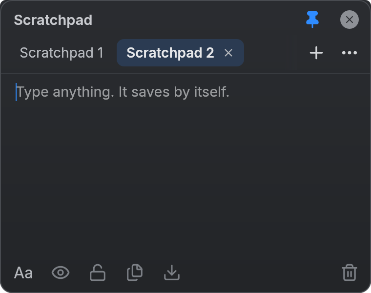
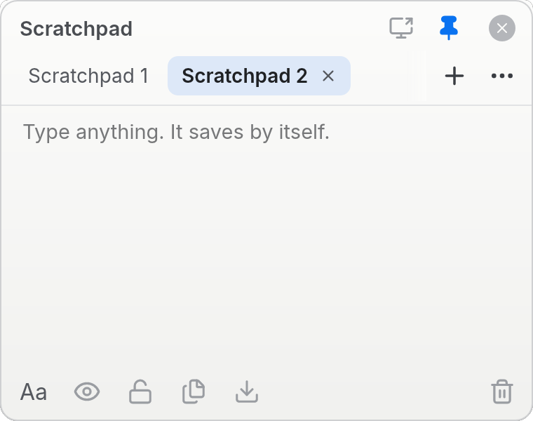
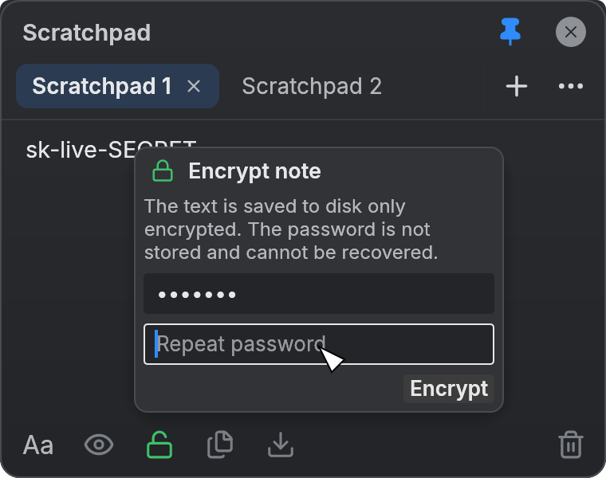
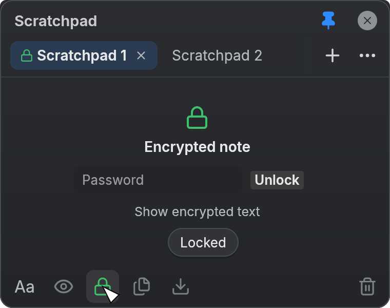

# scrpad

[](https://github.com/mhavo/scrpad/actions/workflows/ci.yml)

A tiny scratchpad: a small, frameless, floating notepad. The window holds only the essentials: multiple notes in tabs, hiding a note from prying eyes (API keys and the like), password encryption, copy to clipboard, save to file, and an "always on top" pin. Everything is saved automatically.



| Light theme | Encrypting a note | Locked note |
|---|---|---|
|  |  |  |

## Download

Prebuilt binaries for Linux (x86_64, aarch64), macOS (universal app for Apple Silicon and Intel) and Windows (x86_64) are on the [Releases](https://github.com/mhavo/scrpad/releases) page. Each archive holds a single executable (on macOS, an app bundle); there is nothing to install. `SHA256SUMS` lists the checksums.

- **Linux:** `tar xzf scrpad-*.tar.gz` and run `scrpad`. Needs glibc 2.35 or newer and working Vulkan or OpenGL drivers.
- **macOS:** `scrpad-*-macos-universal.zip` holds `scrpad.app`, which runs natively on both Apple Silicon and Intel Macs (macOS 10.13 or newer). Drag it to Applications. The app is not notarized, since that needs a paid Apple Developer account, so Gatekeeper blocks the first start of a downloaded copy. Either right-click the app, choose Open and confirm, or clear the quarantine flag once with `xattr -dr com.apple.quarantine /Applications/scrpad.app`.
- **Windows:** extract the zip and run `scrpad.exe`. SmartScreen may warn about an unknown publisher, since the binary is not signed.

## Build

Requires stable Rust 1.85 or newer (the crate uses edition 2024).

```
cargo build --release      # binary at target/release/scrpad
cargo run --release        # or build and run in one go
cargo build --profile dist # smallest binary for distribution, at target/dist/scrpad
```

The `release` profile skips link-time optimization so rebuilds take seconds. `dist` adds full LTO and a single codegen unit: a binary about a third smaller, at the cost of a final link that takes a few minutes.

On Linux, rendering goes through wgpu, so you need working Vulkan or OpenGL drivers.

## Usage

| Action | Mouse | Keyboard |
|---|---|---|
| New note | `+`, or double-click empty space in the tab bar | Ctrl+N / Ctrl+T |
| Close note (Undo from the toast) | tab `×` or middle click | Ctrl+W |
| Rename | double-click the tab, or `…` → Rename | |
| Switch note | click | Ctrl+Tab / Ctrl+Shift+Tab |
| Hide/show content | eye icon | Ctrl+Shift+H |
| Encrypt / lock note | lock icon | Ctrl+Shift+L |
| Show the encrypted text (Esc to go back) | `…` → Show encrypted text | Ctrl+Shift+E |
| Copy all | copy icon | Ctrl+Shift+C |
| Save to file | download icon | Ctrl+S |
| Clear (Undo from the toast) | trash icon | |
| Font (Inter / JetBrains Mono, size) | `Aa` | |
| Theme (dark/light) | `…` | |
| Float on top | pin | |
| Move / resize window | drag the title bar / the edges | |

On macOS, Ctrl means Cmd, except for Ctrl+Tab and Ctrl+Shift+Tab.

Notes are stored in `~/.config/scrpad/notes.json` (macOS: `~/Library/Application Support/scrpad/`, Windows: `%APPDATA%\scrpad\`). If `notes.json` exists but cannot be read, it is moved aside to `notes.json.bak` instead of being overwritten.

## Hiding and encryption

**Hiding** (eye icon) only masks the content on screen, against screenshots and shoulder surfing. A hidden note is still stored as plain text.

**Encryption** (lock icon, next to the eye) protects the note on disk:

- Click the lock on an unencrypted note and set a password (entered twice). The note is now encrypted.
- An encrypted note's text is only ever written to disk encrypted. The plaintext is kept only in memory, passwords are never stored, and locking a note drops its text, password and editor undo history.
- At start-up, encrypted notes are locked; the editor shows a password field to unlock them. Note titles are **not** encrypted.
- On an unlocked encrypted note, click the lock (or press Ctrl+Shift+L) to lock it right away. To decrypt it permanently, use `…` → Remove encryption.
- `…` → Show encrypted text (Ctrl+Shift+E) shows the note exactly as it is saved, as a read-only SimpleTextCrypt message, even while the note is locked. The copy button then copies the encrypted message.
- Save to file on an encrypted note writes the encrypted message, not the plaintext. Copy to clipboard copies the plaintext, since it is already in memory and you asked for it explicitly.

Hiding and encryption are independent. Use both for secrets that should neither be stored in plain text nor be visible on screen.

**Format.** Compatible with SimpleTextCrypt 5.x: the key is derived from the password with Argon2id (t=5, m=64 MiB, p=2) using the random 12-byte IV as the salt, and the text is encrypted with AES-256-GCM. The text form is Base64(IV) followed by Base64(ciphertext‖tag), wrapped at 76 columns. Messages can be decrypted with other SimpleTextCrypt-compatible tools.

**Limits.** Encryption protects data at rest. It does not protect against malware running in your session while a note is unlocked, plaintext that the OS may have written to swap, or a forgotten password: there is no recovery. Memory is not wiped securely, so copies of the plaintext may linger in freed memory until it is reused. Text typed *before* a note was encrypted may already have been autosaved as plain text; the encrypted file replaces it, but the old blocks are not securely erased from the disk. For real secrets, encrypt the note first and type afterwards.

## Why Rust, and how

**Why.** A notepad has to start instantly, stay light and never crash. Rust compiles to a single native binary with no runtime, garbage collector or browser engine; an Electron version would ship all of Chromium. The same code builds for Linux, macOS, Windows and, if needed, WASM. The type system and ownership rules catch typical bugs at compile time, such as data races on state shared between the save thread and the UI.

**How.** The app owns every pixel and asks the operating system for nothing but a window:

1. **egui draws everything.** egui is an *immediate mode* GUI: `App::draw` describes the whole UI on every frame. eframe and wgpu push the triangles to the GPU (Metal, DX12/Vulkan, Vulkan/GL), and winit provides just the window and input. The window is created with `with_decorations(false)` and `with_transparent(true)`; rounded corners, shadows and buttons are all drawn by the app.
2. **Its own design system.** `src/theme.rs`: every colour and radius lives in a `Tokens` struct (dark and light theme). The fonts (Inter, JetBrains Mono) are embedded in the binary. `src/icons.rs`: Lucide SVGs are rasterised at exactly the needed size and tinted with the theme colour. No Unicode glyphs are used as icons.
3. **Platform differences stay at the edges.** The clipboard goes through eframe (`ctx.copy_text`), and the native save dialog uses rfd on its own thread so the window keeps redrawing while the dialog is open. Moving and resizing use `ViewportCommand::StartDrag` and `BeginResize`, since a frameless window has no system title bar to drag.
4. **The result is checked by looking at it.** `tests/ui.rs` drives the real UI headlessly with egui_kittest. The tests click buttons by their accesskit names and render images into `shots/` with wgpu. The same accesskit names are exposed to screen readers.

The trade-offs: the app does not look native, and the binary is about 15 MB (`dist` profile) because of wgpu. A smaller one is possible with eframe's `glow` backend.

## Wayland / Hyprland

On Wayland, an app cannot make its own window "always on top" or choose its position; the compositor decides. The pin works on X11, macOS and Windows through winit's `WindowLevel`.

**Hyprland** is detected from the `HYPRLAND_INSTANCE_SIGNATURE` variable, and through its IPC socket the app does the same as Omarchy's SUPER+O:

- The pin makes the window floating and pinned. Unpinning removes the pin but leaves the window floating.
- When the window is pinned or unpinned with Hyprland's own keys (SUPER+O or SUPER+T), the pin button catches up within about a second.
- The size and position of a floating window are remembered and restored at start-up. The size of a tiled window is not saved.
- Commands are sent first in the new Lua syntax (`hl.dsp.window.pin({ action = "enable", … })`, Hyprland 0.55+), falling back to the old `pin`/`setfloating` syntax.

Elsewhere, the size and, where the platform reports it, the position are read from winit.

## Tests

```
cargo test            # unit tests + headless UI tests, images go to shots/
```

The README images in `docs/` are copies of `shots/dark.png`, `light.png`, `encrypt-popup.png` and `locked.png`. Refresh them after visual changes.

## Releasing

CI (`.github/workflows/ci.yml`) runs clippy and the tests on Linux and checks that the app builds on macOS and Windows. To publish a release, bump `version` in `Cargo.toml`, commit, and push a matching tag:

```
git tag v0.1.0
git push origin v0.1.0
```

`.github/workflows/release.yml` builds the `dist` profile for every platform and creates a GitHub release with the archives, `SHA256SUMS` and generated notes. The release is refused if the tag does not match the version in `Cargo.toml`.

On macOS, `packaging/macos/bundle.sh` turns the Apple Silicon and Intel builds into one universal `scrpad.app`: it joins the binaries with `lipo`, fills in `packaging/macos/Info.plist`, builds the icon with `iconutil` and signs the bundle ad hoc. The same script runs locally on a Mac; its header lists the build commands. A bare executable would open in Terminal when started from Finder, which is why macOS gets an app bundle.

The app icon is drawn in `assets/app-icon/scrpad.svg`. After editing it, re-render the PNG the bundle uses: `inkscape assets/app-icon/scrpad.svg -w 1024 -h 1024 -o assets/app-icon/scrpad.png`.

## License

The code is licensed under the MIT License, see [LICENSE](LICENSE).

Bundled assets keep their own licenses:

- Fonts: Inter and JetBrains Mono, SIL Open Font License 1.1 (`assets/fonts/OFL-*.txt`).
- Icons: Lucide, ISC License (`assets/icons/LICENSE-lucide.txt`).
